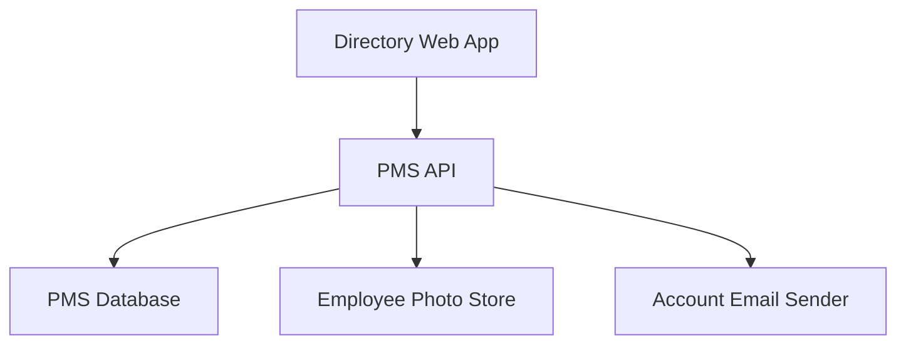
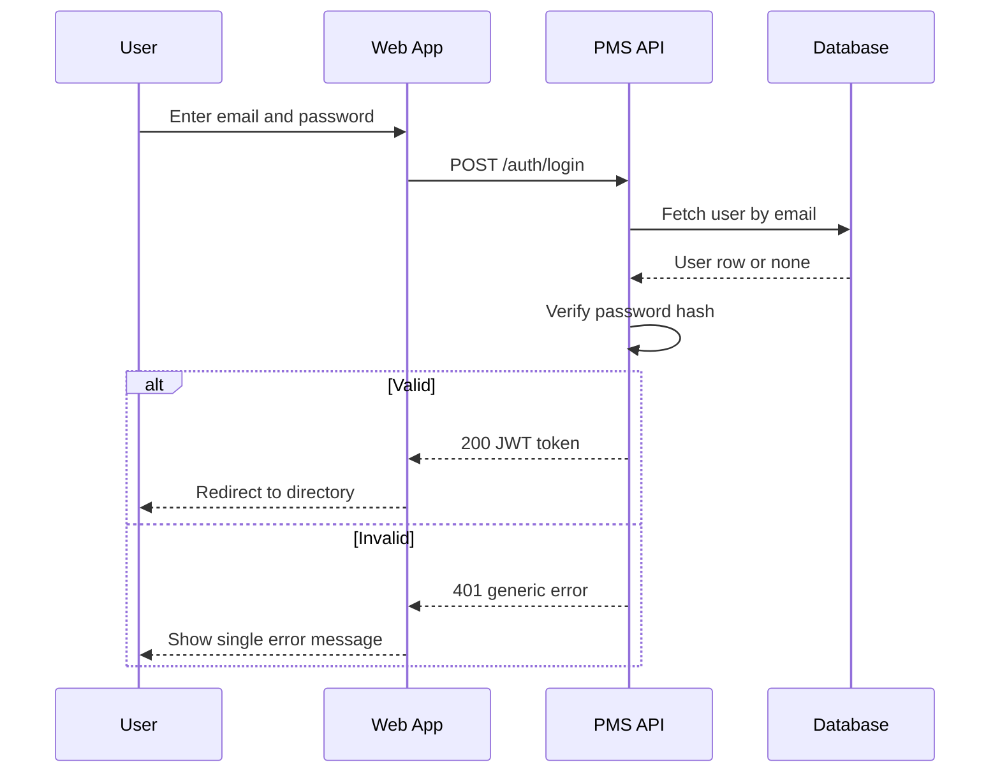
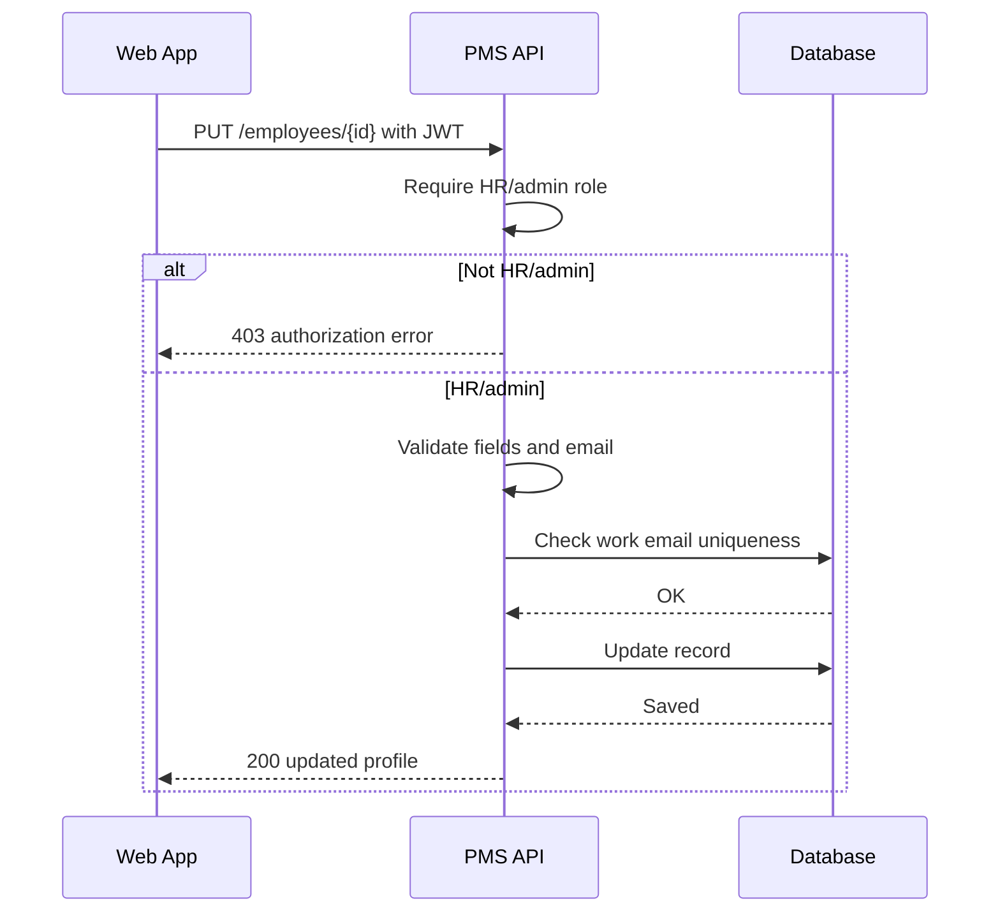
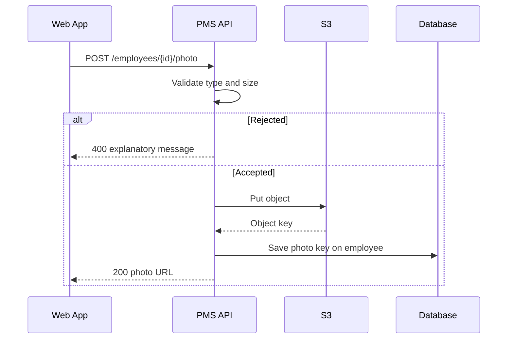
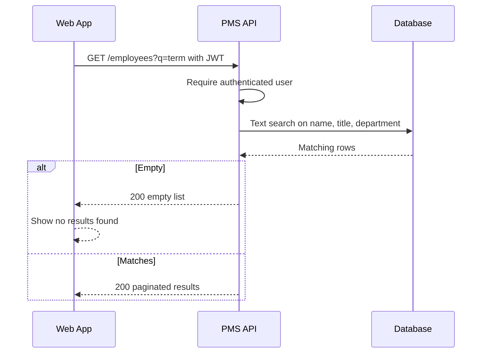
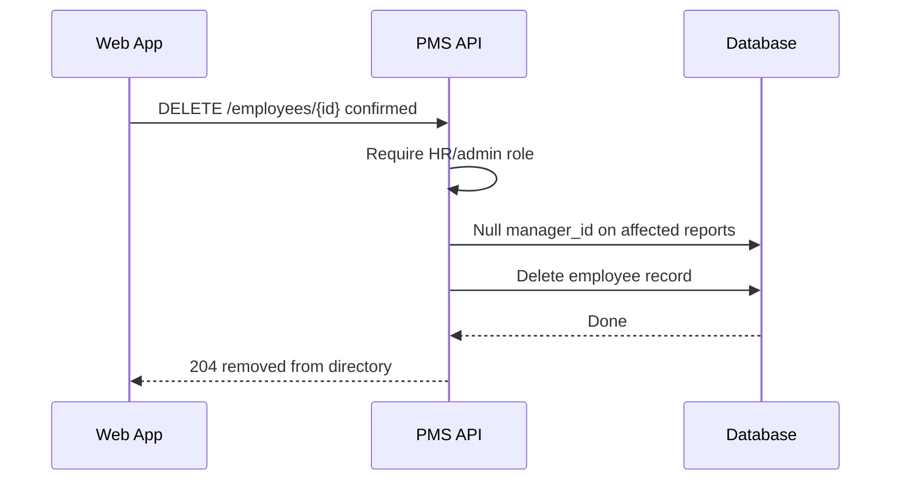
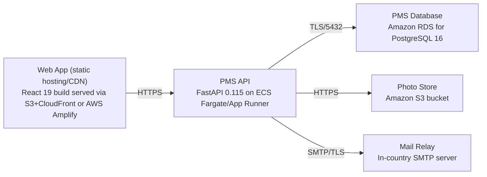

# Architecture

> Maintained by QuorQ AI SDLC. Text between `sdlc:auto` markers is regenerated; anything outside them is yours and is kept.

<!-- sdlc:auto:start narrative -->
## Overview

### ARCH-001 · approved · source: architecture:summary

PMS is approved (v1) as a lightweight in-country people-management directory: React 19 web app, FastAPI 0.115 backend, PostgreSQL 16, S3 for optional photos, SMTP for account emails, all pinned to a single AWS region for data residency.

Overall architecture summary, approved status, version 1. HR/admin users create, edit and remove employee records and manage departments/reporting lines; all authenticated users browse, search (PostgreSQL text search) and view profiles. Access is governed by JWT sessions and two roles (HR/admin, regular employee), with edit/add/remove refused server-side for regular employees. Single-region AWS deployment chosen specifically to satisfy single-country data residency.

- ⚠ No approver name or approval date provided for the 'approved' status.
- ⚠ No explicit mapping given from this architecture to specific US-xxx requirement IDs.

### ARCH-002 · approved · source: architecture:component:web_frontend

Directory Web App is a responsive React 19 list-and-detail UI covering login, directory search/browse, profile view, and HR/admin management screens.

Component: web_frontend - Directory Web App (React 19). Responsibilities: login screen, directory search/browse, profile view, and HR/admin create/edit/remove plus department/reporting-line management. Hides edit controls for regular employees (client-side role gating, backed by server-side enforcement per ARCH-008) and redirects unauthenticated users to login.

### ARCH-003 · approved · source: architecture:component:api_backend

PMS API is a FastAPI 0.115 REST service handling auth/JWT, role-based authorization, employee/department/reporting CRUD, directory search, photo upload orchestration, and account emails.

Component: api_backend - PMS API (FastAPI 0.115). Responsibilities: authentication/JWT issuance, role-based authorization, employee/department/reporting CRUD with validation, directory search, photo upload orchestration to S3, and account provisioning/reset emails via SMTP.

### ARCH-004 · approved · source: architecture:component:database

PMS Database is PostgreSQL 16, storing user accounts/roles, employee records, departments and manager reporting lines, and serving full-text search.

Component: database - PMS Database (PostgreSQL 16). Stores user accounts/roles, employee records, departments and manager reporting lines; serves full-text search by name/title/department; enforces unique work email constraint.

### ARCH-005 · approved · source: architecture:component:photo_storage

Employee Photo Store is an Amazon S3 bucket holding optional employee profile photos as objects, kept in-region and out of the database.

Component: photo_storage - Employee Photo Store (Amazon S3). Stores and serves optional employee profile photos as objects, keeping images out of the relational database and within the approved AWS region for residency.

### ARCH-006 · approved · source: architecture:component:email_service

Account Email Sender is an in-country SMTP server used for account-setup and password-reset emails.

Component: email_service - Account Email Sender (SMTP server). Sends account-setup and password-reset emails through the organisation's in-country mail server, consistent with data-residency requirements.

### ARCH-007 · approved · source: architecture:critical_path:login

Login critical path: credentials are checked against a hashed password; success issues a JWT, failure returns one generic error.

Email/password login: user submits credentials; backend verifies against hashed password, issues a JWT on success, and returns a single non-revealing error on failure (no distinction between unknown email and wrong password, per design).

### ARCH-008 · approved · source: architecture:critical_path:role_enforced_edit

Role-enforced record edit: server re-validates HR/admin role and field validity on every edit, regardless of client-side UI state.

Role-enforced record edit: HR/admin edits an employee; backend re-checks role server-side and validates fields before persisting, refusing regular employees with an authorization error. This is the server-side backstop for the frontend's UI-level control hiding (see ARCH-002).

### ARCH-009 · approved · source: architecture:critical_path:photo_upload

Photo upload: backend validates type/size before storing to S3 and linking the object key to the employee; failed validation leaves the old photo untouched.

Photo upload to S3: HR/admin uploads an image; backend checks type and size, stores the object in S3, saves the key on the employee, and leaves the old photo in place if validation fails.

### ARCH-010 · approved · source: architecture:critical_path:directory_search

Directory search: authenticated users search by partial name, title, or department using PostgreSQL text search.

Directory search: authenticated user searches by partial name, title or department; backend runs a PostgreSQL text search and returns matches or a no-results signal.

### ARCH-011 · approved · source: architecture:critical_path:remove_employee

Employee removal safely clears or reassigns dangling manager references after confirmation.

Remove employee with reporting-line safety: HR/admin deletes a record after confirmation; backend reassigns or clears manager references that point to the removed employee to avoid dangling reporting lines.

- ⚠ Input does not specify whether reassignment is automatic (and to whom) or simply cleared to null -- confirm with design/dev output.

### ARCH-012 · approved · source: architecture:entities

Data model has three entities: users, departments, and employees, with employees self-referencing for manager/reporting lines.

users: id, email, password_hash, role, is_active, created_at. departments: id, name, created_at. employees: id, name, job_title, department_id, work_email, phone, manager_id, location, start_date, photo_key, created_at, updated_at. employees.manager_id is self-referencing to support reporting lines; employees.work_email is unique per database component notes (ARCH-004).

### ARCH-013 · approved · source: architecture:endpoints

The API exposes 14 REST endpoints covering auth, admin user management, employee CRUD/search/photo, and department management.

POST /auth/login - authenticate and issue JWT, single generic error on mismatch. POST /auth/logout - end session. POST /admin/users - provision HR/admin account, triggers setup email. PATCH /admin/users/{id} - revoke/reactivate HR/admin account. POST /auth/password-reset - send password-reset email via SMTP. GET /employees - search/browse with pagination and department filter. GET /employees/{id} - full profile including manager and direct reports. POST /employees - create with validation and unique work email. PUT /employees/{id} - update with same validation. DELETE /employees/{id} - remove record and clear dangling reporting lines after confirmation. POST /employees/{id}/photo - upload/replace photo in S3 after type/size validation. GET /departments - list for browsing/filtering. POST /departments - create department. DELETE /departments/{id} - delete department, refused if it still has assigned employees.

### ARCH-014 · approved · source: architecture:deployment_nodes

Deployment topology: static-hosted React build, FastAPI on ECS Fargate/App Runner, RDS PostgreSQL 16, S3 bucket, and an in-country SMTP relay, all single-region.

Web App: React 19 build served via S3+CloudFront or AWS Amplify (static assets). PMS API: FastAPI 0.115 on ECS Fargate/App Runner, Python 3.12 + Uvicorn. PMS Database: Amazon RDS for PostgreSQL 16. Photo Store: Amazon S3 bucket (object storage). Mail Relay: in-country SMTP server.

- ⚠ Choice between CloudFront/Amplify for web hosting and between ECS Fargate/App Runner for the API is left open ('or') -- final selection not yet pinned down in this input.

### ARCH-015 · approved · source: architecture:technology_decisions

Four technology decisions recorded with alternatives considered: React 19, FastAPI 0.115, PostgreSQL 16, and AWS single-region, each with stated rationale.

Frontend: React 19 chosen over Vue/Svelte for a responsive list-and-detail directory UI consuming the REST API and gating HR/admin controls by role. Backend: FastAPI 0.115 chosen over Django REST Framework/Flask for CRUD/auth/search endpoints with built-in Pydantic validation, comfortable headroom at tens of concurrent users. Database: PostgreSQL 16 chosen over MySQL/SQLite for its relational fit to employees/departments/self-referencing manager lines and built-in full-text search at a few-thousand-record scale, avoiding a separate search engine. Cloud: AWS chosen over Azure/GCP so single-region RDS PostgreSQL and S3 keep all employee data and photos inside the operating country, satisfying in-country residency with one provider.
<!-- sdlc:auto:end narrative -->

<!-- sdlc:auto:start building-blocks -->
## Building Block View

| ID | Name | Technology | Responsibility | Depends on |
|---|---|---|---|---|
| web_frontend | Directory Web App | React 19 | Responsive list-and-detail UI for login, directory search/browse, profile view, and HR/admin create/edit/remove and department/reporting management; hides edit controls for regular employees and redirects unauthenticated users to login. | api_backend |
| api_backend | PMS API | FastAPI 0.115 | REST API handling authentication/JWT issuance, role-based authorization, employee/department/reporting CRUD with validation, directory search, photo upload orchestration to S3, and account provisioning/reset emails via SMTP. | database, photo_storage, email_service |
| database | PMS Database | PostgreSQL 16 | Stores user accounts/roles, employee records, departments and manager reporting lines; serves full-text search by name/title/department and enforces unique work email. | — |
| photo_storage | Employee Photo Store | Amazon S3 | Stores and serves optional employee profile photos as objects, keeping images out of the database and in-region. | — |
| email_service | Account Email Sender | SMTP server | Sends account-setup and password-reset emails through the organisation's in-country mail server. | — |

<!-- sdlc:auto:end building-blocks -->

<!-- sdlc:auto:start runtime -->
## Runtime View

### Email/password login

User submits credentials; backend verifies against hashed password, issues a JWT on success, and returns a single non-revealing error on failure.

- **Components:** web_frontend, api_backend, database
- **Modules:** auth.router, auth.service, security.password, security.jwt
- **Key functions:** login(email, password), verify_password(plain, hash), create_access_token(user_id, role)

### Role-enforced record edit

HR/admin edits an employee; backend re-checks role server-side and validates fields before persisting, refusing regular employees with an authorization error.

- **Components:** web_frontend, api_backend, database
- **Modules:** employees.router, employees.service, auth.deps, employees.validators
- **Key functions:** require_hr_admin(current_user), update_employee(id, payload), validate_work_email_unique(email, exclude_id)

### Photo upload to S3

HR/admin uploads an image; backend checks type and size, stores the object in S3, saves the key on the employee, and leaves the old photo if validation fails.

- **Components:** web_frontend, api_backend, photo_storage, database
- **Modules:** employees.photo_router, storage.s3, employees.image_validator
- **Key functions:** upload_photo(id, file), validate_image(file), put_object(bucket, key, bytes)

### Directory search

Authenticated user searches by partial name, title or department; backend runs a PostgreSQL text search and returns matches or a no-results signal.

- **Components:** web_frontend, api_backend, database
- **Modules:** directory.router, directory.service
- **Key functions:** search_employees(query, department, page), build_search_query(term)

### Remove employee with reporting-line safety

HR/admin deletes a record after confirmation; backend reassigns or clears manager references that point to the removed employee to avoid dangling reporting lines.

- **Components:** web_frontend, api_backend, database
- **Modules:** employees.router, employees.service
- **Key functions:** delete_employee(id), clear_reports_manager(manager_id)

<!-- sdlc:auto:end runtime -->

<!-- sdlc:auto:start deployment-view -->
## Deployment View

| Name | Service | Runtime | Scaling | Environment |
|---|---|---|---|---|
| Web App (static hosting/CDN) | React 19 build served via S3+CloudFront or AWS Amplify | Static assets | CDN-cached | dev |
| PMS API | FastAPI 0.115 on ECS Fargate/App Runner | Python 3.12 + Uvicorn | 1-2 small tasks for tens of concurrent users | dev |
| PMS Database | Amazon RDS for PostgreSQL 16 | PostgreSQL 16 | Single-AZ dev instance | dev |
| Photo Store | Amazon S3 bucket | Object storage | Managed | dev |
| Mail Relay | In-country SMTP server | SMTP | Managed externally | dev |

| Source | Target | Protocol |
|---|---|---|
| Web App (static hosting/CDN) | PMS API | HTTPS |
| PMS API | PMS Database | TLS/5432 |
| PMS API | Photo Store | HTTPS |
| PMS API | Mail Relay | SMTP/TLS |

<!-- sdlc:auto:end deployment-view -->

<!-- sdlc:auto:start decisions -->
## Architecture Decisions

| Layer | Choice | ADR |
|---|---|---|
| Frontend | React 19 | [ADR-0001](adr/frontend.md) |
| Backend | FastAPI 0.115 | [ADR-0002](adr/backend.md) |
| Database | PostgreSQL 16 | [ADR-0003](adr/database.md) |
| Cloud | AWS | [ADR-0004](adr/cloud.md) |
<!-- sdlc:auto:end decisions -->

<!-- sdlc:auto:start links -->
## Related Documents

- [Data Model](data-model.md)
- [API Specification](api/openapi.yaml)
- [Architecture Decision Records](adr/README.md)
<!-- sdlc:auto:end links -->
