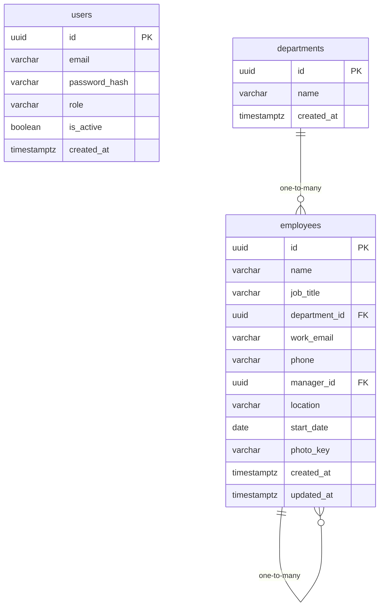

# Data Model

<!-- sdlc:auto:start entities -->
### users

| Field | Type | PK | FK | Nullable |
|---|---|---|---|---|
| id | uuid | True | — | False |
| email | varchar | False | — | False |
| password_hash | varchar | False | — | False |
| role | varchar | False | — | False |
| is_active | boolean | False | — | False |
| created_at | timestamptz | False | — | False |

### departments

| Field | Type | PK | FK | Nullable |
|---|---|---|---|---|
| id | uuid | True | — | False |
| name | varchar | False | — | False |
| created_at | timestamptz | False | — | False |

### employees

| Field | Type | PK | FK | Nullable |
|---|---|---|---|---|
| id | uuid | True | — | False |
| name | varchar | False | — | False |
| job_title | varchar | False | — | True |
| department_id | uuid | False | departments.id | True |
| work_email | varchar | False | — | False |
| phone | varchar | False | — | True |
| manager_id | uuid | False | employees.id | True |
| location | varchar | False | — | True |
| start_date | date | False | — | True |
| photo_key | varchar | False | — | True |
| created_at | timestamptz | False | — | False |
| updated_at | timestamptz | False | — | False |
<!-- sdlc:auto:end entities -->

<!-- sdlc:auto:start relationships -->
| Source | Target | Type |
|---|---|---|
| departments | employees | one-to-many |
| employees | employees | one-to-many |
<!-- sdlc:auto:end relationships -->

<!-- sdlc:auto:start er-diagram -->

<!-- sdlc:auto:end er-diagram -->
