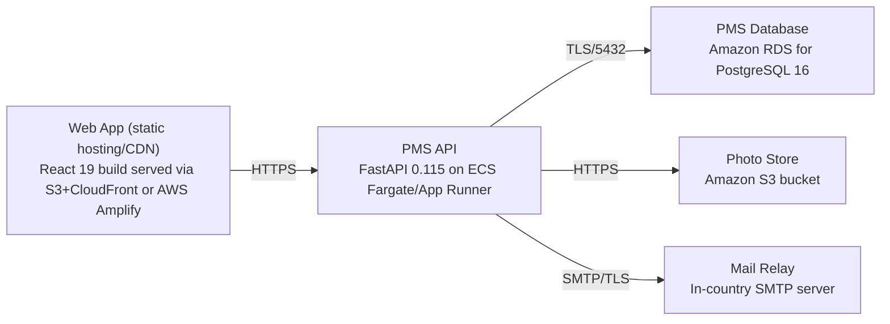

# Deployment Guide

> Maintained by QuorQ AI SDLC. Text between `sdlc:auto` markers is regenerated; anything outside them is yours and is kept.

<!-- sdlc:auto:start how-it-deploys -->
Pushes to `main` run `.github/workflows/deploy.yml`, which builds the API image (if there is a backend) and deploys the SPA to AWS Amplify. Commits touching only `docs/sdlc/**` don't deploy. Deployments can also be started from the platform's Deployment tab.
<!-- sdlc:auto:end how-it-deploys -->

<!-- sdlc:auto:start environments -->
| Name | Service | Runtime | Scaling | Environment |
|---|---|---|---|---|
| Web App (static hosting/CDN) | React 19 build served via S3+CloudFront or AWS Amplify | Static assets | CDN-cached | dev |
| PMS API | FastAPI 0.115 on ECS Fargate/App Runner | Python 3.12 + Uvicorn | 1-2 small tasks for tens of concurrent users | dev |
| PMS Database | Amazon RDS for PostgreSQL 16 | PostgreSQL 16 | Single-AZ dev instance | dev |
| Photo Store | Amazon S3 bucket | Object storage | Managed | dev |
| Mail Relay | In-country SMTP server | SMTP | Managed externally | dev |
<!-- sdlc:auto:end environments -->

<!-- sdlc:auto:start live -->
_Not deployed yet._
<!-- sdlc:auto:end live -->

<!-- sdlc:auto:start topology -->

<!-- sdlc:auto:end topology -->
